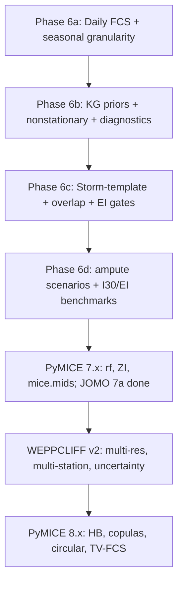

# WEPPCLIFF × PyMICE — Future Improvements Roadmap

**Version:** 1.0  
**Date:** 26 June 2026  
**Companion:** `PYMICE_INTEGRATION_PLAN.md` (current implementation plan)

This document records deliberate shortcuts in the Phase 6a integration and the better statistical or engineering choices to adopt later. Each item names what blocks the upgrade today (PyMICE, WEPPCLIFF v2, or both).

---

## Cluster granularity

| # | Current shortcut | Better choice | Blocker | Target |
|---|------------------|---------------|---------|--------|
| B1 | Bootstrap **stability** for granularity selection | **Leave-one-season-out CV** imputation RMSE | Adapter must be stable; compute cost | WEPPCLIFF 6b |
| B2 | **Lat-band 4 seasons** (NH/SH flip) | **Köppen-informed seasons** (tropical wet/dry, monsoon) | No KG season mapper | WEPPCLIFF 7.x |
| B3 | **`n_min = max(30, 5p)`** rule | **Condition-number / MP** stability on Σ | Needs benchmarks | WEPPCLIFF 6b |
| B4 | **Adjacent-season pooling** when sparse | **Spatial borrow** from neighboring stations in same KG zone | Single-station CLI | WEPPCLIFF v2 |

**Policy (not a shortcut):** Global (1-cluster) granularity is **removed**. Coarsest tier is **seasonal (4)**.

---

## Tier A — Statistical model shortcuts

| # | Current shortcut | Better choice | Blocker | Target |
|---|------------------|---------------|---------|--------|
| A1 | Daily **FCS + `quickpred`** (default) | **Multivariate block** via **`-jm t`** (`jomoImpute` / `panImpute`) | ✅ PyMICE 7a; opt-in CLI flag | WEPPCLIFF 7.x default review |
| A2 | **Sub-daily row-wise** FCS in 6a | **Storm-template donor** resampling (`ANT`/`BTW`/`CUM` preserved) | ✅ `storm_template.py` (6c) | WEPPCLIFF 7.x tuning |
| A3 | **`m = 1`** single draw | **`m > 1`** with uncertainty export | WEPP/WEPPCLIFF expect point values | WEPPCLIFF v2 schema |
| A4 | **Hybrid heuristic** (per-cluster vs `2l.norm`) | Formal **model selection** (CV error, BIC) | No selection API | PyMICE 7.x |
| A5 | **`quickpred` Pearson** | **Tail-aware / copula** predictor selection for precip | Not in PyMICE | PyMICE 8.x |
| A6 | **`cart` / `logreg` for EVENT** | **Zero-inflated / hurdle** occurrence model | Not registered | PyMICE 7.x |
| A7 | **W_DIR** sin/cos + `pmm` | **Circular regression** | No circular methods | PyMICE 8.x |
| A8 | **Stationary** default | **Time-varying** FCS (decade blocks, rolling window) | Config + long-record validation | WEPPCLIFF 6b |
| A9 | Dew as ordinary continuous | **Passive** `~` from T + RH when available | Variable availability varies | WEPPCLIFF 6b |
| A10 | **`2l.norm` Gibbs approx** (univariate path) | Fortran **bit-parity** with R `pan::pan()` | ✅ `jomoImpute`/`panImpute` via `ml_jomo_impute`; RNG differs | PyMICE core (optional) |

---

## Tier B — Köppen priors

| # | Current shortcut | Better choice | Blocker | Target |
|---|------------------|---------------|---------|--------|
| B3 | Deferred to 6b | **Hierarchical Bayesian** station nested in KG zone | No HB in PyMICE | PyMICE 8.x |
| B5 | Not in 6a | **Shrunk correlation / regression** blend when local *n* small | Prior DB not built | WEPPCLIFF 6b |
| B6 | Planetary KG pool for marginals | **Zone-only** priors (no planetary global pool) | Complete KG coverage | Prior calibration pipeline |

---

## Tier C — Sub-daily / EI / storms

| # | Current shortcut | Better choice | Blocker | Target |
|---|------------------|---------------|---------|--------|
| C1 | **Duplicate-merge + DUR trim** overlap patch | **Interval scheduling** + `identify_storms` re-pass | Storm-template not ready | WEPPCLIFF 6c |
| C2 | **ELEN / BPS** separate from breakpoint sequence | **Joint generative** storm-count → breakpoints → depths | No generative model | WEPPCLIFF 7.x |
| C3 | Daily PRECIP sum **post hoc** | **Passive sum constraints** across levels during FCS | Cross-level passive not wired | WEPPCLIFF 6c |
| C4 | EI not gating v1 | Hold-out **I30 / EI / PRATIO** benchmarks | Needs storm-template + harness | WEPPCLIFF 6d |
| C5 | Cluster-only diurnal donors | **KG + elevation** intraday profile library | Prior DB lacks sub-daily | Prior calibration 7.x |
| C6 | Aggregate-then-disaggregate mixed Δt | **Multi-resolution graph** with daily constraints | No harmonize layer in v2 | WEPPCLIFF v2 |

---

## Tier D — Engineering

| # | Current shortcut | Better choice | Blocker | Target |
|---|------------------|---------------|---------|--------|
| D1 | **Mean-fill fallback** on PyMICE failure | Fail with diagnostics once adapter is validated | Need confidence | Post-6a validation |
| D2 | **Fresh `mice()` per cluster** | **`mice.mids()`** warm-start | Not in PyMICE | PyMICE 7.x |
| D3 | **Staged `fill_data` pipeline** preserved | Three-level **graphical model** refactor | Large refactor risk | WEPPCLIFF v2 |
| D4 | Fixed `maxit`; `qi` → cart only | **`convergence()`** early stop | Not wired in adapter | WEPPCLIFF 6b |
| D5 | No user-facing imputation report | `md_pattern`, granularity, prior weight | Reporting layer missing | WEPPCLIFF 6b |
| D6 | Autotest skips gap-fill | **Synthetic gap-fill** regression + EI metrics | Tests not built | WEPPCLIFF 6d |
| D7 | **`cart` only** via `[ml]` extra | **`rf`** for precip tails | `rf` not registered | PyMICE 7.x |

---

## Tier E — Climate nonstationarity

| # | Current shortcut | Better choice | Blocker | Target |
|---|------------------|---------------|---------|--------|
| E1 | Stationary seasonal relationships | Explicit **nonstationary** mode (`-ns`) | ✅ `-ns t` (6b) | WEPPCLIFF 7.x validation |
| E2 | Static KG calibration | **Rolling prior refresh** | Operational pipeline | External data ops |
| E3 | Single-station imputation | Regional **network borrow** | CLI is single-station | WEPPCLIFF v2 |
| E4 | No trend modeling | Regime-shift detection alters prior weight | Research scope | Long-term |

---

## Retirement order

**Highest impact after 6d:** B1 + B2 (CV granularity + KG seasons) → C4 (EI hold-out benchmarks) → A1 default-on review for `-jm` → A3 (`m > 1` uncertainty export).

---

## Explicitly retained defaults (post-6d)

- Coarsest cluster tier: **seasonal (4)**, never global
- Daily **FCS + `quickpred`** by default; **`-jm t`** enables multivariate JOMO/PAN block
- **Storm-template** sub-daily when `-st t` (default)
- **`m = 1`**
- **Mean-fill fallback** when `-pm f` or PyMICE errors