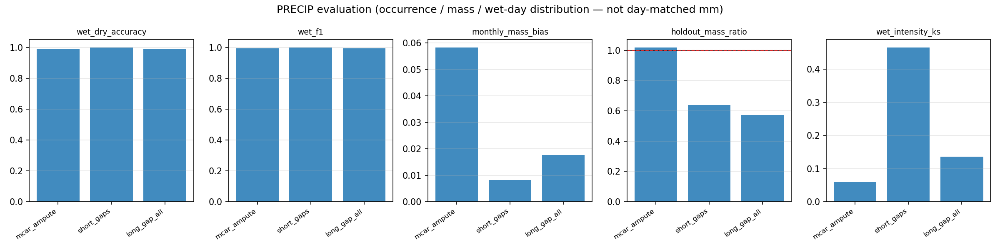
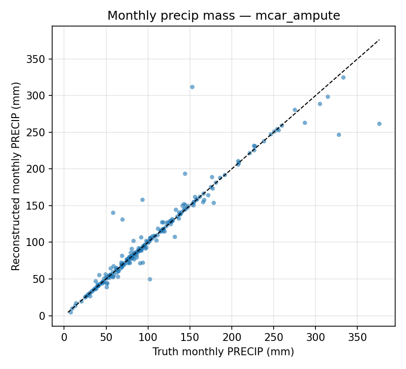
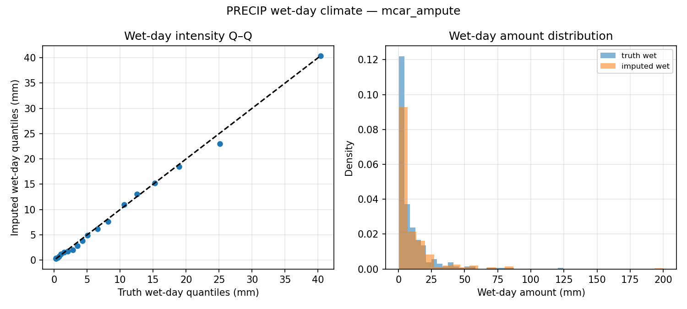
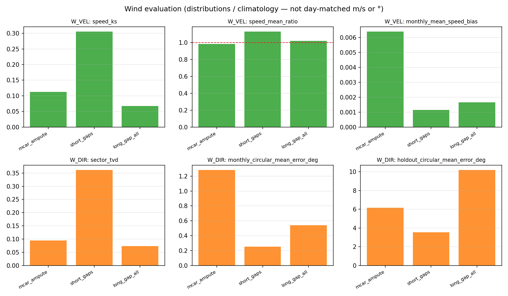
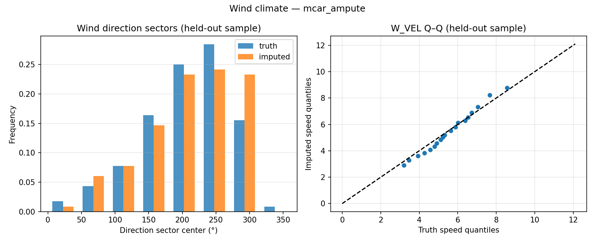
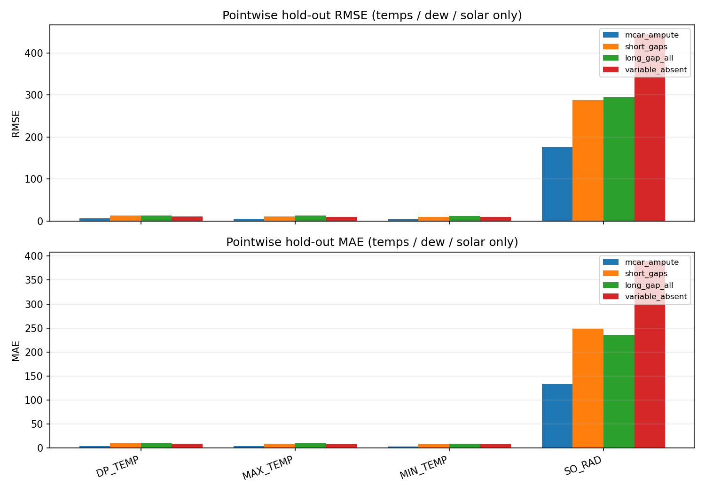

# Summary

Climate is both a primary driver of erosion and one of the most labor-intensive inputs to soil-loss models such as the Water Erosion Prediction Project [WEPP, @USDA:1995] and the USLE family of erosivity calculations [@Wischmeier:1978; @Renard:1997; @USDA:2013]. The original **WEPPCLIFF** software [@McGehee:2020] is an R command-line tool that quality-checks weather observations, gap-fills missing periods with multivariate imputation [@vanBuuren:2011], separates storms, computes erosion indices, and writes WEPP climate files—including true **breakpoint** precipitation that preserves observed intensity structure rather than discarding it into CLIGEN-style summaries [@Nicks:1995; @USDA:2019].

This paper documents the **Python port of WEPPCLIFF** and a substantial redesign of its gap-filling stack. Beyond a faithful port of core workflows (QC, storm separation, EI, `.cli` export), the new system adds:

1. **PyMICE FCS** — a Python multivariate imputation engine (`-pm`) with midastouch/cart methods, optional nonstationary predictors, and JOMO/PAN blocks [@PyMICE:2026];
2. **Storm-template sub-daily fill** (`-st`) that preserves breakpoint spacing needed for \(I_{30}\) and EI;
3. **PHIGI** (*Physics-Informed Hierarchical Generative Imputation*, `-gf phigi`) — a directed L0–L6 pipeline that computes clear-sky radiation, imputes cloud transmittance, applies weather-type structure and Köppen priors [@Beck:2018], and uses a hurdle model for precipitation;
4. **Climate-aware validation** — precipitation and wind are scored on occurrence, mass, and distributions, not day-matched millimetres or degrees.

Together these changes make gap filling more physically consistent, more transparent (structured imputation reports), and more honestly evaluated for weather variables that are inherently stochastic at the daily scale.

# Statement of need

Erosion models still often run on outdated climate normals or weather-generator parameters rather than quality-controlled observed series [@Srivastava:2019; @McGehee:2018]. Preparing breakpoint WEPP inputs by hand is impractical for multi-year continuous simulation. The R WEPPCLIFF release addressed that tooling gap [@McGehee:2020], but production use exposed structural limits of treating all weather fields as interchangeable continuous MICE targets:

- Solar radiation is largely deterministic given latitude, day of year, and cloudiness; inventing raw SO_RAD with FCS can corrupt every downstream variable.
- Precipitation is a mixed discrete–continuous process; day-matched amount error is a poor skill score for gap fills and weather generators.
- Wind direction is circular; linear RMSE in degrees is misleading.
- Sub-daily gap fill can collapse inter-breakpoint timing and bias erosivity even when daily totals look acceptable.

A modern stack needs physics where physics is known, hierarchical structure where climate regimes matter, and evaluation metrics aligned with how climate is used in soil-loss modelling (monthly mass, wet-day climate, intensity structure)—not only NA-fill rates.

# Software description

## Core pipeline (parity with R WEPPCLIFF)

The Python package retains the original WEPPCLIFF mission:

- Ingest ASOS/AWOS-style and related station files; unit conversion; datetime control.
- Quality control (physical limits; spike / streak / stick heuristics).
- Storm separation (time and depth thresholds) and multi-equation EI / kinetic energy.
- Export of daily, storm, breakpoint, and WEPP `.cli` products.
- Plotting and Autotest / tutorial harnesses for regression safety.

Installation, CLI flags, and tutorials are documented in the repository `README.md` and `Documentation/Manual.md`.

## Gap-filling engines

| Engine | CLI | Role |
| --- | --- | --- |
| Cluster mean fill | `-id` without `-pm` | Legacy-simple fallback |
| Staged PyMICE FCS | `-id -pm` (`-gf legacy`) | Multivariate MICE within clusters; default modern staged path |
| Storm templates | `-st` with `-pm` | Sub-daily precip donor resampling for EI-safe spacing |
| PHIGI | `-id -pm -gf phigi` | Directed L0–L6 physics-informed pipeline + optional `-ir` report |

**PHIGI layers (summary):**

- **L0** — astronomical clear-sky radiation and calendar skeleton.
- **L1** — Köppen zone and calibrated seasonal priors.
- **L2** — weather-type mixture components.
- **L3** — directed daily posterior (\(\tau\), temperatures, moisture, wind); PyMICE optional subroutine.
- **L4** — hurdle precipitation (occurrence → amount → storm attributes).
- **L5–L6** — storm generation / template application, EI-oriented checks, export and report.

Legacy staged fill remains available so users and Autotest can compare engines without abandoning existing workflows.

# Evaluation design

## Why not day-matched precip and wind error?

For continuous, strongly autocorrelated fields (daily minimum/maximum temperature, dew point, solar radiation under a transmittance model), comparing imputed values to held-out observations on the **same day** is a fair primary metric.

For **precipitation** and **wind**, day identity is the wrong scientific target:

| Variable family | Primary metrics in this study | Avoid as primary |
| --- | --- | --- |
| Temps / dew / solar | Hold-out RMSE, MAE, \(R^2\) | — |
| Precipitation | Wet/dry accuracy & F1; monthly & seasonal mass bias; wet-day intensity KS / quantiles; hold-out mass ratio | Day-matched mm RMSE |
| Wind speed | KS between held-out samples; mean ratio; monthly mean speed bias | Day-matched m/s RMSE |
| Wind direction | 8-sector histogram total variation; monthly circular-mean error | Day-matched degree RMSE |

This matches how gap-filled climate is used: to force continuous erosion simulations with realistic **climate statistics**, not to reconstruct a specific lost Tuesday.

## Ampute–impute protocol (AutoTest.1 / KMQE)

We use the standard WEPPCLIFF daily export for station AutoTest.1 (KMQE-class ASOS record; \(n = 6940\) days) after full processing. For each random seed:

1. Assign weather clusters on the complete panel.
2. Ampute under three missingness scenarios: **MCAR** (12% random), **short gaps** (scattered multi-day holes), **long gap** (one contiguous multi-month hole of all variables).
3. Impute with cluster-wise PyMICE midastouch (`io = 20` iterations in the multiseed study).
4. Score with the climate-aware metrics above.

The experiment is repeated for **\(N = 30\) independent seeds** (seeds \(0\)–\(29\)). Tables report mean \(\pm\) sample standard deviation across seeds. Full replicate CSVs live under `JOSS-PAPER/results/`.

**Results freeze (2026-07-26):** all 90 jobs (30 seeds \(\times\) 3 scenarios) completed successfully with PyMICE midastouch and `io = 20`. Reproducible via `Development/scripts/autotest1_ampute_impute_multiseed.py`.

# Results

## Multiseed performance (\(N = 30\))

<!-- AUTO:MULTISEED_TABLE -->

Seeds 0–29; PyMICE midastouch; io=20; climate-aware scoring for PRECIP/wind.
Values are mean ± sample standard deviation across 30 independent seeds.

| Metric | mcar_ampute | short_gaps | long_gap_all |
| --- | --- | --- | --- |
| Pointwise RMSE (mean of 4 vars) | 47.182 ± 3.168 | 86.588 ± 8.499 | 84.928 ± 3.340 |
| MIN_TEMP RMSE (°C) | 4.423 ± 0.530 | 12.220 ± 1.393 | 11.162 ± 0.439 |
| MAX_TEMP RMSE (°C) | 4.956 ± 0.796 | 13.313 ± 1.533 | 12.187 ± 0.585 |
| DP_TEMP RMSE (°C) | 5.719 ± 0.615 | 13.604 ± 1.726 | 13.029 ± 0.516 |
| SO_RAD RMSE (Ly) | 173.630 ± 12.568 | 307.214 ± 32.000 | 303.333 ± 12.377 |
| PRECIP wet/dry accuracy | 0.985 ± 0.008 | 0.983 ± 0.033 | 0.985 ± 0.013 |
| PRECIP wet-day F1 | 0.992 ± 0.004 | 0.991 ± 0.017 | 0.992 ± 0.007 |
| PRECIP monthly mass bias | 0.049 ± 0.008 | 0.011 ± 0.006 | 0.020 ± 0.005 |
| PRECIP holdout mass ratio | 0.928 ± 0.045 | 0.571 ± 0.327 | 0.701 ± 0.122 |
| PRECIP wet-day intensity KS | 0.056 ± 0.014 | 0.335 ± 0.102 | 0.126 ± 0.040 |
| W_VEL speed KS | 0.095 ± 0.025 | 0.199 ± 0.062 | 0.110 ± 0.025 |
| W_VEL mean ratio | 0.975 ± 0.029 | 0.994 ± 0.086 | 1.013 ± 0.033 |
| W_VEL monthly mean bias | 0.006 ± 0.001 | 0.002 ± 0.001 | 0.002 ± 0.001 |
| W_DIR sector TVD | 0.111 ± 0.040 | 0.226 ± 0.082 | 0.102 ± 0.028 |
| W_DIR monthly circ. mean err (°) | 1.585 ± 0.239 | 0.309 ± 0.100 | 0.503 ± 0.102 |

Full replicates: `Autotest/Output/AmputeImpute/multiseed/replicates.csv`

<!-- /AUTO:MULTISEED_TABLE -->

**Reading the table.**

- **Pointwise RMSE** applies only to MIN_TEMP, MAX_TEMP, DP_TEMP, and SO_RAD. Lower is better.
- **PRECIP wet/dry accuracy** and **wet-day F1** near 1 indicate correct occurrence structure on held-out days.
- **Monthly mass bias** near 0 means reconstructed monthly totals stay close to truth after gap fill (the series is truth outside amputed cells).
- **Holdout mass ratio** near 1 means aggregate millimetres on amputed cells are conserved even though individual days are not matched.
- **Wet-day intensity KS** near 0 means the *distribution* of wet-day depths matches; it is not a paired-day test.
- **Wind speed KS** and **sector TVD** near 0, **mean ratio** near 1, and small **monthly circular direction error** indicate climatological wind fidelity.

## Illustrative single-seed climate diagnostics

Figures below are from a representative seed (see also `Autotest/Output/AmputeImpute/`).













# New versus legacy features

Table 2 contrasts the original R / staged-legacy path with the Python PyMICE + PHIGI stack. A machine-readable copy is in `results/TABLE_feature_comparison.md`.

| Capability | Legacy (R WEPPCLIFF / `-gf legacy`) | New (Python PyMICE + PHIGI) |
| --- | --- | --- |
| Language / runtime | R + CRAN `mice` | Python 3.10+ + PyMICE FCS |
| Solar radiation | Generic continuous MICE target | Clear-sky \(R^{cs}\); impute transmittance \(\tau\) (PHIGI) |
| Climate structure | Calendar month / half-month clusters | Köppen zone, seasons, weather-type mixtures |
| Precipitation | Joint continuous fill | Hurdle occurrence → amount → storm attributes |
| Sub-daily precip | Row-wise FCS (spacing at risk) | Storm-template donors (`-st`) for EI-safe timing |
| Nonstationarity | Not supported | Year-block predictors (`-ns`) |
| Regional priors | Limited | Calibrated Köppen × season prior store |
| Temperature order | Soft / ad hoc | Directed stage + hard MIN ≤ MAX constraints |
| Validation focus | Often day-matched residuals / fill rate | Erosivity-aware + climate-aware metrics |
| Reporting | Plots / console | Optional JSON imputation report (`-ir`) |
| Opt-in path | `-id` / `-qi` / `-im` | Adds `-pm`, `-st`, `-ns`, `-kg`, `-jm`, `-gf phigi`, `-tauqc`, `-ir` |
| Safety | R reference CLI | Autotest + `.cli` parity; `-gf legacy` retained |

# Usage sketch

```bash
# Staged PyMICE gap fill (modern default multivariate path)
python weppcliff.py -f ASOS_BPT_KMQE.csv -la y -id -pm -st

# Physics-informed hierarchical engine + report
python weppcliff.py -f ASOS_BPT_KMQE.csv -la y -id -pm -gf phigi -ir

# Multiseed climate-aware evaluation (this paper)
python Development/scripts/autotest1_ampute_impute_multiseed.py --n 30 --workers 4
```

# Availability

| Artifact | Location |
| --- | --- |
| Python WEPPCLIFF (working tree) | `/Users/home/Software/Grok/WEPPCLIFF` |
| This paper package | `JOSS-PAPER/` (`paper.md`, `paper.bib`, `figures/`, `results/`) |
| Multiseed table | `JOSS-PAPER/results/TABLE_multiseed_summary.md` |
| Feature comparison | `JOSS-PAPER/results/TABLE_feature_comparison.md` |
| Replicate CSVs | `JOSS-PAPER/results/multiseed_replicates.csv` |
| Single-seed diagnostics | `Autotest/Output/AmputeImpute/` |

The original R WEPPCLIFF JOSS paper and software remain the archival reference for the 2020 design [@McGehee:2020]. PyMICE is developed alongside WEPPCLIFF as a reusable FCS library [@PyMICE:2026].

# Acknowledgements

This work builds directly on the R WEPPCLIFF design and validation culture established with colleagues at Purdue University and the USDA ARS National Soil Erosion Research Laboratory [@McGehee:2020].

# References
